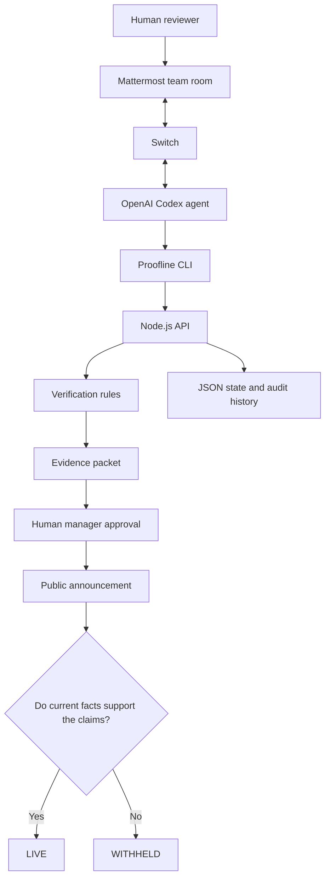

\# Proofline - Evidence Before Promises


\*\*Agents investigate. Rules verify. Humans authorize. Promises remain accountable to changing facts.\*\*


\*\*BuiltByBhavesh | Flip the Switch Hackathon 2026 | Best Business Workflow\*\*


\## The problem


A company can publish a promise in seconds. But who checks whether the promise is true - and whether it remains true tomorrow?


Imagine a marketing team advertising:-


\- Berlin delivery within one day

\- Aurora headphones available in stock

\- A thirty-day return policy


But its actual records show Berlin delivery takes \*\*two business days\*\*, Aurora stock is \*\*zero\*\*, and the returns policy is indeed \*\*thirty days\*\*.


Two promises are unsupported. Only one is valid


\*\*Proofline prevents unsupported business promises from reaching customers.\*\*


Its key principle is simple:-


> Yesterday's approval cannot make today's false promise true


\## What Proofline does


Proofline is a human-controlled, evidence-backed announcement workflow


An AI agent can investigate business facts, prepare structured claims, propose corrections and request approval


The backend independently checks each claim against operational records. The AI cannot override these checks


A human manager must approve the verified announcement before publication


Most importantly, if operational evidence changes after approval, Proofline rechecks the announcement and automatically withholds it when it is no longer supported


\## The five-stage workflow


1\. \*\*Investigate:\*\* The agent examines a marketing draft and current operational facts

2\. \*\*Verify:\*\* The backend checks delivery estimates, stock availability and returns policies

3\. \*\*Correct:\*\* Unsupported claims are revised or removed, and an evidence receipt is prepared

4\. \*\*Approve:\*\* A separate human manager authorizes publication through a protected dashboard

5\. \*\*Monitor:\*\* The public endpoint checks current evidence and withholds invalid announcements


\## Architecture





Switch and Codex form the collaborative agent interface. The Proofline business rules, approval gate and public endpoint run independently of the AI


\## Run the application


\*\*Requirements:\*\* Node.js 20 or later.


No paid API key, npm package installation or external database is required for the backend


Open PowerShell inside the directory containing `server.mjs`:


```powershell

node .\\\\server.mjs

```


Open:


\- Manager dashboard: http://127.0.0.1:4173

\- Public announcement: http://127.0.0.1:4173/live


The server prints a private manager PIN. Never publish it or include it in recordings


In a second PowerShell window, run:-


```powershell

node .\\\\tool.mjs facts

node .\\\\tool.mjs inbox

node .\\\\tool.mjs help

```


\## Reproduce the business workflow


Reset the demo using the \*\*Reset workspace\*\* control in the manager dashboard


Create the original claims:-


```powershell

node .\\\\tool.mjs add PL-1000 delivery Berlin 1

node .\\\\tool.mjs add PL-1000 stock AURORA 1

node .\\\\tool.mjs add PL-1000 returns policy 30

node .\\\\tool.mjs case PL-1000

```


Expected results:-


| Claim | Decision |

|---|---|

| Berlin delivery in 1 day | BLOCKED |

| One AURORA headphone in stock | BLOCKED |

| Thirty-day returns | VERIFIED |


Correct the unsupported claims:


```powershell

node .\\\\tool.mjs revise PL-1000 C1 2

node .\\\\tool.mjs remove PL-1000 C2

node .\\\\tool.mjs submit PL-1000

```


The IDs above apply to a fresh workspace. If using an existing case, inspect its claim IDs first


Open the dashboard, select `PL-1000`, enter the private manager PIN and choose \*\*Approve \& publish\*\*.


The public page should now show only the verified two-day Berlin delivery and thirty-day returns statements


Then, in the dashboard's \*\*Simulate an operational change\*\* section, change Berlin delivery to four business days


Refresh the public page


\*\*Expected: WITHHELD.\*\*


Proofline prevents a previously approved, now-invalid promise from remaining public


\## Connecting an agent with Switch


During development, I configured a local Switch server with Mattermost and an OpenAI Codex agent named `proofline-agent`


The collaborative room was `#proofline-review`


The agent uses Proofline's restricted `tool.mjs` interface to investigate and work with structured business claims.


For a new installation:


1\. Install and authenticate the Codex CLI using your own ChatGPT account

2\. Start a local Switch server and its bundled Mattermost

3\. Connect Codex as the agent provider

4\. Create `proofline-agent` using `AGENTS.md`

5\. Create a private Mattermost room called `proofline-review` using `ROOM-INSTRUCTIONS.txt`

6\. Restrict agent access to the owner, disable automatic permission bypass and require approval for commands

7\. Point the agent to the absolute path of `tool.mjs` when needed


\*\*Integration status:\*\* Switch successfully connected Codex to Mattermost and executed real tool calls during development. Later sessions were blocked by a revoked Codex authentication token. The submitted illustrated video demonstrates independently tested backend behavior, rather than a complete recording of the live Switch chat workflow


This distinction is intentional and transparent


\## Technical implementation


\- Node.js 20+ with standard-library HTTP server.

\- Deterministic verification of structured claims.

\- Local JSON persistence and audit history.

\- Human PIN-gated publication.

\- SHA-256 evidence receipts.

\- Revalidation before approval.

\- Dynamic public verification against current operational facts.

\- Automatic withdrawal of unsupported published statements.

\- Restricted local server bound to `127.0.0.1`.


The original untrusted marketing text is never published directly. Public statements are generated from checked structured claims


\## Automated tests


Run:-


```powershell

npm test

```


Six tests cover claim checking, invalid stock promises, stale approval packets, automatic withdrawal, persistence, and the HTTP approval workflow


The backend requires no AI access to execute these tests


\## Demonstration


\*\*Video:\*\* Add the YouTube or Loom link here.


The demonstration uses fictional operational facts to illustrate real backend decisions, human approval and automatic withdrawal


The video is an illustrated application walkthrough, not a continuous live Switch agent recording


\## Limitations and future work


Proofline is a hackathon prototype, not a production compliance system


It currently uses fictional inventory, delivery and policy data rather than integrations with live enterprise systems


A production deployment would require stronger identity management, authorization, database transactions, event-driven integrations, immutable evidence storage and external monitoring


The local manager PIN is a demonstration safeguard, not production authentication. SHA-256 receipts provide evidence digests, not cryptographic signatures from a trusted third party


\## Why it matters


Most AI writing tools focus on generating more content


Proofline focuses on whether a business can \*\*justify publishing that content — and keep justifying it as reality changes\*\*


The AI investigates. The backend verifies. A human authorizes. Operational evidence determines whether a public promise remains valid


\*\*Proofline - Evidence Before Promises.\*\*


\---


Built by \*\*BuiltByBhavesh\*\* for Flip the Switch Hackathon 2026

MIT License

